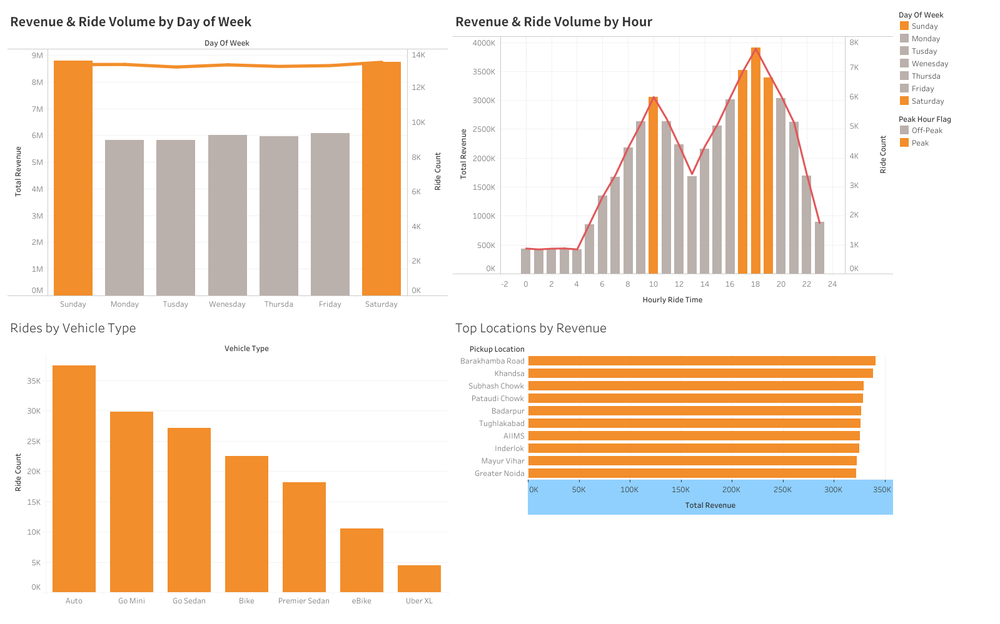
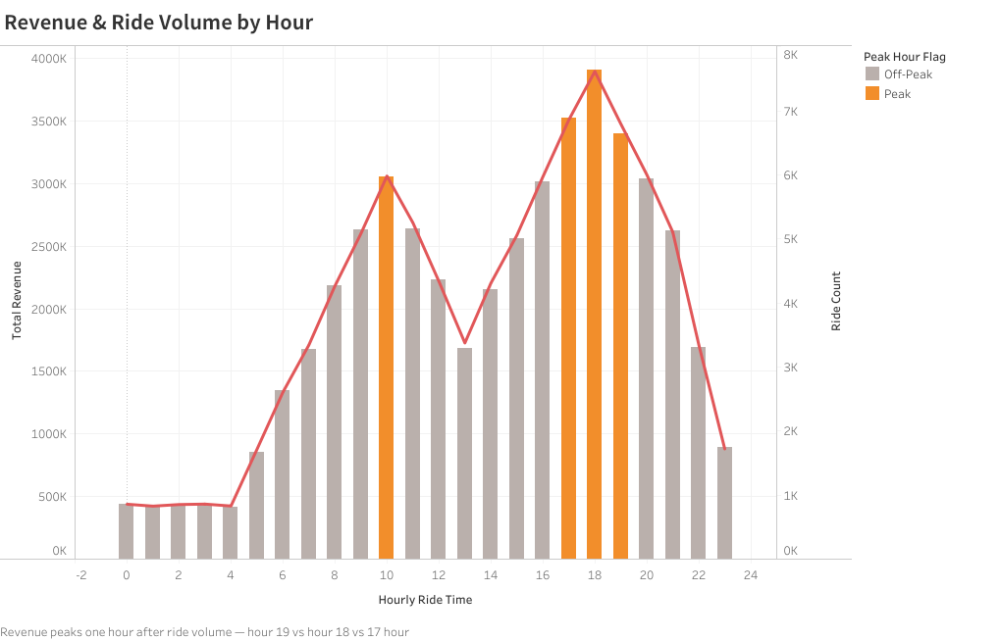
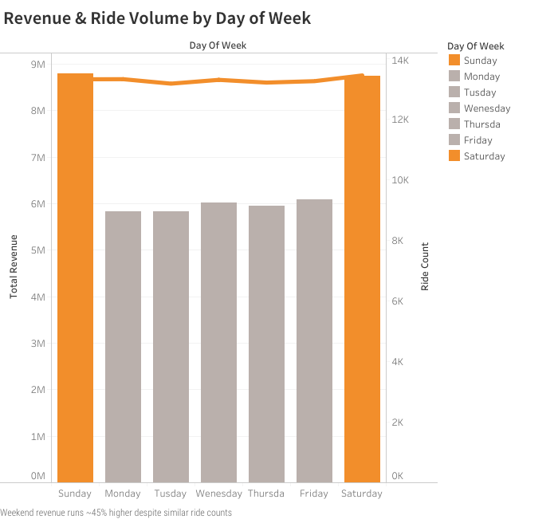
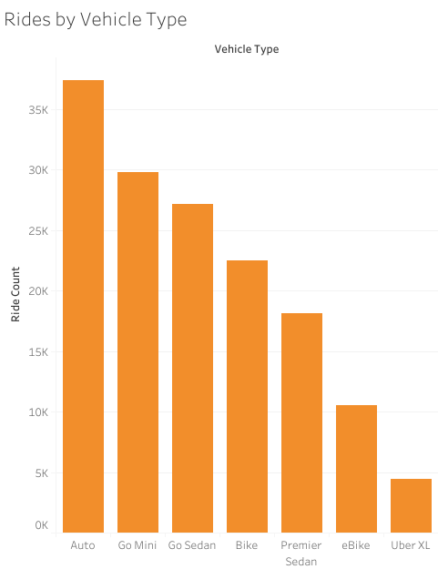
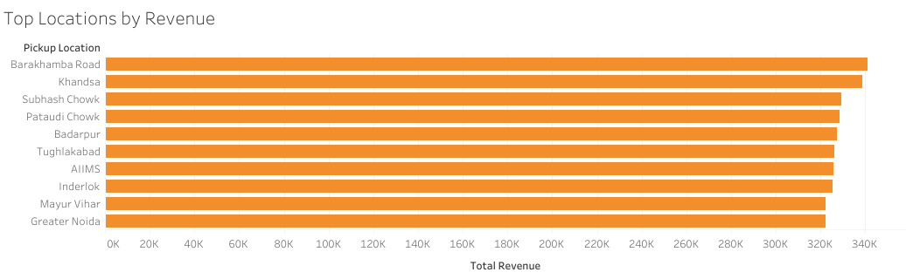
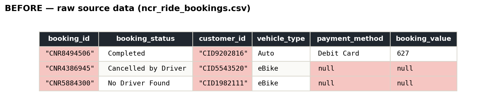
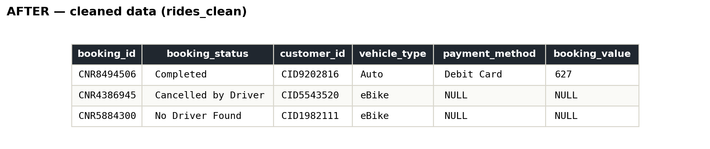

# Uber Ride-Hailing Data Analysis

**A SQL-based exploratory analysis of ~150,000 ride-hailing bookings, uncovering demand patterns, revenue drivers, and operational outliers.**

**Tools:** PostgreSQL · Beekeeper Studio · Tableau Public
**Skills demonstrated:** GROUP BY / HAVING, CASE WHEN, EXTRACT, conditional aggregation, window functions, data quality auditing, business interpretation, dashboard design

🔗 **[View the interactive dashboard on Tableau Public](https://public.tableau.com/views/Uber_Ride_Hailing_Analysis/UberRide-HailingAnalysisKeyPatterns?:language=en-US&:sid=&:redirect=auth&:display_count=n&:origin=viz_share_link)**

---

## Contents

1. [Quick summary](#quick-summary-30-second-skim)
2. [Dataset context](#dataset-context)
3. [How to reproduce](#how-to-reproduce)
4. [Interactive dashboard](#interactive-dashboard)
5. [Before / after: the data cleaning](#before--after-the-data-cleaning)
6. [Cleaning process](#cleaning-process)
7. [Data quality issues found during analysis](#data-quality-issues-found-during-analysis-beyond-initial-cleaning)
8. [Exploratory analysis](#exploratory-analysis)
9. [Case study: payment method & revenue risk](#case-study-payment-method--revenue-risk)
10. [Recommendations](#recommendations)
11. [Files in this repo](#files-in-this-repo)
12. [What I'd do next](#what-id-do-next)

---

## Quick summary (30-second skim)

- Ride **volume** peaks at 6 PM, but **revenue** peaks at 7 PM — a one-hour gap between "busiest" and "most valuable."
- Ride count is nearly flat across all 7 days of the week, but **weekend revenue runs ~45% higher** than weekday revenue — driven by **pricing, not trip length or vehicle mix**.
- Two specific pickup locations (Akshardham, Vinobapuri) cancel **~29-30% of rides** (z-score ~3.0), well above the ~25% average — driven by **driver-side cancellations**, not longer wait times.
- Found and corrected a data-structure trap: comparing cancellation rate by payment method looks dramatic (0% vs. 78%) but is meaningless, since payment method is only ever recorded on completed rides.

---

## Dataset context

- **Source:** [Uber Ride Analytics Dashboard (Kaggle)](https://www.kaggle.com/datasets/yashdevladdha/uber-ride-analytics-dashboard) by Yash Devladdha
- **Geography:** Delhi NCR, India
- **Currency:** INR (₹)
- **Date range:** January 1, 2024 – December 30, 2024 (full calendar year)
- **Revenue definition:** `booking_value` on completed rides only; cancelled/incomplete rides have no recorded value
- **Note:** Public educational dataset — not proprietary Uber operational data

---

## How to reproduce

**Prerequisites:** PostgreSQL 14+ and a SQL client (Beekeeper Studio, psql, or DBeaver)

1. **Download the dataset** from [Kaggle](https://www.kaggle.com/datasets/yashdevladdha/uber-ride-analytics-dashboard) and save the CSV locally as `ncr_ride_bookings.csv`
2. **Create a database** (e.g. `uber_analysis`)
3. **Run the cleaning script** — open [`00_data_cleaning.sql`](./00_data_cleaning.sql), create the `rides_raw` staging table, then load the CSV:
   ```sql
   \copy rides_raw FROM 'path/to/ncr_ride_bookings.csv' WITH (FORMAT csv, HEADER true);
   ```
   Continue through the rest of `00_data_cleaning.sql` to build `rides_clean`
4. **Run the analysis scripts** in order:
   - [`01_exploratory_analysis.sql`](./01_exploratory_analysis.sql) — Q1 through Q10
   - [`02_payment_method_case_study.sql`](./02_payment_method_case_study.sql)
5. **View the dashboard** on [Tableau Public](https://public.tableau.com/views/Uber_Ride_Hailing_Analysis/UberRide-HailingAnalysisKeyPatterns?:language=en-US&:sid=&:redirect=auth&:display_count=n&:origin=viz_share_link)

> CSV files are excluded from this repo via `.gitignore` — download from Kaggle using the link above.

---

## Interactive dashboard



The full dashboard combines four views — revenue & ride volume by hour, revenue & ride volume by day of week, rides by vehicle type, and top pickup locations by revenue — all built in Tableau Public.

👉 **[Explore it live here](https://public.tableau.com/views/Uber_Ride_Hailing_Analysis/UberRide-HailingAnalysisKeyPatterns?:language=en-US&:sid=&:redirect=auth&:display_count=n&:origin=viz_share_link)**

### Revenue & ride volume by hour


Volume peaks at hour 18; revenue peaks at hour 19 — a one-hour gap between busiest and most valuable, highlighted in orange.

### Revenue & ride volume by day of week


Ride count is flat across the week; weekend revenue (highlighted) is not — running ~45% higher than weekdays despite similar volume.

### Rides by vehicle type


### Top locations by revenue


---

## Before / after: the data cleaning

Real rows from the raw source file, shown exactly as they were stored — highlighted cells mark the problems fixed during cleaning.



Issues visible above: **quote characters embedded directly in ID fields** (`"CNR8494506"` instead of `CNR8494506`), and **missing values stored as the literal text `null`** rather than a true blank.



Same rows after cleaning: quotes stripped from IDs, `booking_status` and `customer_id` cleaned up. Look closely at row 1, though — `booking_value` correctly shows `(NULL)`, but `payment_method` still holds the literal text `null`. That's not a mistake in this screenshot; it's the residual cleaning gap described below, caught live and left in deliberately as honest evidence rather than a polished mockup.

Full profiling → cleaning process detailed below and in [`00_data_cleaning.sql`](./00_data_cleaning.sql).

## Before / after, in numbers

| | Raw (`ncr_ride_bookings.csv`) | Cleaned (`rides_clean`) |
|---|---|---|
| Rows | 150,000 | 148,767 (1,233 duplicates removed) |
| Columns | 21 | 15 |
| Duplicate booking IDs | 1,233 | 0 |
| IDs with embedded quote characters | 150,000 | 0 |
| Literal `'null'` text strings | present across all columns | 0 (all converted to true NULL) |

Source: NCR ride-hailing bookings dataset, 150,000 rows, 21 columns. Profiling the raw data before touching it surfaced four real issues:

- **Booking IDs and Customer IDs contained literal embedded quote characters** — the actual stored text was `"CNR5884300"`, quotes included as part of the string, not CSV formatting.
- **Missing values were written as the literal text `null`** across every column, not as true blank/NULL values — a source-file convention that affects far more than one column.
- **Booking status was fragmented across 6 columns** instead of one — `Booking Status` plus five more (`Cancelled Rides by Customer`, `Reason for cancelling by Customer`, `Cancelled Rides by Driver`, `Driver Cancellation Reason`, `Incomplete Rides`, `Incomplete Rides Reason`) — largely redundant with the single `Booking Status` field for aggregate analysis.
- **1,233 duplicate Booking IDs** in the raw 150,000 rows.

## Cleaning process

Full transformation in [`00_data_cleaning.sql`](./00_data_cleaning.sql). In summary:

- Stripped the embedded quote characters from `booking_id` and `customer_id`
- Converted every literal `'null'` string to a true SQL `NULL` using `NULLIF()`
- Cast text-typed numeric fields (`booking_value`, `ride_distance`, ratings, etc.) to proper `numeric`, and combined date/time into typed `date`/`time` columns
- Dropped the 6 redundant status/reason columns, keeping the single `booking_status` field (21 columns → 15)
- De-duplicated on `booking_id` using `ROW_NUMBER() OVER (PARTITION BY booking_id ...)`, keeping one row per ID

**A known gap, found honestly rather than hidden:** despite this cleaning pass, the actual analysis table still contained rows where `payment_method` held the literal string `'null'` rather than a true NULL. This wasn't caught at cleaning time — it surfaced mid-analysis (see below) and had to be handled defensively with `NULLIF()` again at query time. One cleaning pass doesn't guarantee every downstream query is safe; profiling is worth repeating, not just doing once at the start.

## Data quality issues found *during* analysis (beyond initial cleaning)

Even after the initial cleaning pass, two issues surfaced while running the exploratory analysis — a reminder that data quality checks don't stop after step 1:

- **`payment_method` contains a literal text string `'null'`** in some rows, distinct from a true SQL NULL. This silently creates an extra, incorrect group in any `GROUP BY payment_method` unless explicitly caught with `NULLIF(payment_method, 'null')`.
- **`booking_status` cancellations are split across two values** (`'Cancelled by Customer'`, `'Cancelled by Driver'`) rather than one unified `'Cancelled'` status — a naive `WHERE booking_status = 'Cancelled'` silently returns zero rows instead of erroring, which is a dangerous kind of bug to miss.

## Exploratory analysis

Full queries in [`01_exploratory_analysis.sql`](./01_exploratory_analysis.sql).

| Question | Finding |
|---|---|
| Overall baseline | Avg booking value ~508, avg distance ~24.7 km across completed rides |
| Vehicle type breakdown | Booking value and distance both flat across vehicle types — fare isn't distance-driven |
| Hourly pattern | Volume peaks hour 18, revenue peaks hour 19 |
| Day-of-week pattern | Ride count flat all week; weekend revenue ~45% higher than weekday |
| Cancellation by vehicle type | Flat ~24-25% across all types — not a meaningful driver |
| Top locations by volume vs. revenue | Different rankings — busiest ≠ most valuable |
| Cancellation by location | Akshardham & Vinobapuri outliers at ~29-30%, vs. ~25% average |
| Fare vs distance (Q9) | Correlation ≈ 0.005 — fare not linearly driven by km |
| Outlier validation (Q10) | Akshardham & Vinobapuri z-scores ~3.0 — statistically meaningful |

### Weekend revenue deep-dive

Ride distance is nearly identical between weekdays and weekends (25.98 km vs 26.05 km), ruling out "longer trips" as the explanation. The real driver is price: average booking value is 46% higher on weekends (₹655.51 vs ₹448.67), almost exactly matching the earlier revenue gap.

**Vehicle mix doesn't explain it either (Q7):** premium vehicle share is nearly flat (~14.8% weekend vs ~15.2% weekday). The weekend premium is almost certainly **dynamic/surge pricing**, not a shift toward more expensive vehicle types.

### Outlier location deep-dive

Akshardham and Vinobapuri both cancel ~29.6% of rides — z-scores of ~3.0 against a fleet mean of 25.0% (σ ≈ 1.5%), with 800+ rides each. This is unlikely to be random noise.

**Wait times are not the problem (Q8):** average VTAT at both locations (~8.4 min) matches the fleet average. The signal is **cancellation type** — driver cancellations run ~20–22% vs ~8–9% customer cancellations, roughly 2.5× the customer rate. This points to a **driver-side supply or acceptance issue** at these zones, not a passenger wait-time problem.

## Case study: payment method & revenue risk

Full queries in [`02_payment_method_case_study.sql`](./02_payment_method_case_study.sql).

Investigated whether payment method predicts cancellation risk, revenue, or ride quality — for a hypothetical finance team concerned about processing risk. Found that payment method has **no meaningful relationship** with booking value or ratings, and that an apparent link to cancellation rate is actually a data-structure artifact (payment method is only recorded on completed rides), not a real business signal. Catching that distinction — rather than reporting misleading numbers at face value — was the actual point of the exercise.

## Recommendations

- **Shift driver incentives to 7 PM, not 6 PM.** Ride volume peaks at 6 PM, but revenue peaks an hour later at 7 PM. Bonuses timed to volume alone are chasing the wrong peak — better to align incentives with the hour that actually drives revenue.
- **Target driver supply at Akshardham and Vinobapuri.** Both locations cancel ~30% of rides (z-score ~3.0), driven by driver-side cancellations at roughly 2.5× the customer rate — not longer wait times. Ops should investigate driver availability and acceptance rates at these zones specifically.
- **Weekend revenue is a pricing lever, not a distance or mix effect.** Average booking value is ~46% higher on weekends with identical trip distances and flat vehicle mix. Dynamic pricing on Sat/Sun is the confirmed revenue driver.
- **Deprioritize payment method as a risk signal.** No real relationship between payment method and cancellation risk — the apparent link was a data artifact, not a business signal.
- **Don't use distance alone to model fare.** Correlation between `booking_value` and `ride_distance` is ≈ 0.005 — pricing models need vehicle type, time-of-day, and surge factors, not just km.

## Files in this repo

- [`00_data_cleaning.sql`](./00_data_cleaning.sql) — raw → clean transformation
- [`01_exploratory_analysis.sql`](./01_exploratory_analysis.sql) — Q1–Q10 core analysis
- [`02_payment_method_case_study.sql`](./02_payment_method_case_study.sql) — payment method case study
- [`images/`](./images/) — before/after cleaning screenshots and dashboard chart exports
- [Live interactive dashboard](https://public.tableau.com/views/Uber_Ride_Hailing_Analysis/UberRide-HailingAnalysisKeyPatterns?:language=en-US&:sid=&:redirect=auth&:display_count=n&:origin=viz_share_link)

## What I'd do next

- Add dashboard KPI cards (completion rate, avg booking value, cancellation rate) and a cancellation-by-location view in Tableau
- Add cross-filters between day-of-week and hourly charts for drill-down
- Break down monthly cancellation and revenue trends across the full 2024 calendar year
- Investigate driver cancellation *reasons* at Akshardham and Vinobapuri if reason codes become available

---

## Push to GitHub (step-by-step)

Do this once from your project folder in Terminal:

```bash
cd ~/Downloads/uber

# 1. Initialize git (skip if already done)
git init

# 2. Stage portfolio files (.gitignore excludes CSVs and large files)
git add README.md .gitignore *.sql images/

# 3. Check what will be committed — should NOT list .csv or .pbix files
git status

# 4. Commit
git commit -m "Add Uber ride-hailing SQL analysis portfolio"

# 5. Create a new repo on GitHub (github.com → New repository)
#    Name it e.g. uber-ride-hailing-analysis — do NOT add README/gitignore on GitHub

# 6. Connect and push (replace YOUR_USERNAME with your GitHub username)
git branch -M main
git remote add origin https://github.com/YOUR_USERNAME/uber-ride-hailing-analysis.git
git push -u origin main
```

**After pushing, on GitHub:**
1. Add a description: `SQL + Tableau analysis of 150K Delhi-NCR ride bookings — demand patterns, cancellation outliers, data quality case study`
2. Add topics: `sql`, `postgresql`, `tableau`, `data-analysis`, `data-cleaning`
3. Pin the repo on your profile if it's a portfolio centerpiece

**Optional (Tableau — you do this manually):**
- Open your Tableau workbook and add KPI cards + cancellation view
- Republish to Tableau Public and update the link in README if the URL changes
